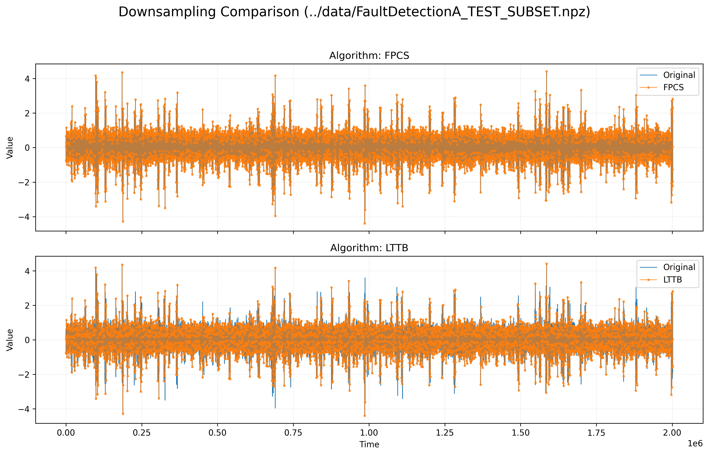

# FPCS - Feature-Preserving Compensated Sampling

[](https://opensource.org/licenses/MIT)

**FPCS** is a high-performance time series downsampling algorithm designed to
preserve critical visual features (peaks and valleys) while significantly
reducing data size. It is particularly well-suited for real-time visualization
and streaming data applications.

Implementation based on the [Feature-Preserving Compensated Sampling for Time
Series Visualization](https://ieeexplore.ieee.org/document/10669793)
publication.

---

## Why FPCS?

Unlike simple decimation or even some advanced algorithms like LTTB, FPCS
selects sampling-window extrema and compensates across adjacent windows,
helping preserve prominent peaks and valleys while allowing smaller local
extrema to be dropped.

### Visual Comparison (FPCS vs LTTB)
FPCS helps retain prominent peaks and valleys at high downsampling ratios,
whereas LTTB may miss sharp spikes in noisy datasets, as illustrated below.



### Key Features
- **High Performance:** Cython-optimized core is competitive with optimized LTTB
  (see benchmarks below).
- **Streaming data:** Supports incremental processing via `FPCSDownsampler`.
- **Feature preserving:** Selects window extrema with compensation for
  features that would otherwise be lost between windows.
- **Robust:** Discards points with `NaN` or infinite coordinates.
- **Batched processing:** Efficiently downsample multiple series at once.

---

## Installation

```bash
# Install from PyPI
pip install fpcs
```

**Requirements**
- Python >= 3.11
- NumPy

**Optional (for the Cython extension)**
- C compiler and Python headers
- Cython (the package falls back to the pure Python backend if Cython isn't
  available)

```bash
# Install from source (local checkout)
pip install .

# For development (includes Cython, pytest, benchmarks)
pip install -e ".[dev]"
```

---

## Usage

### Batch Downsampling
Processing existing datasets:
```python
import numpy as np
from fpcs import downsample

# Generate 1M points
x = np.arange(1_000_000, dtype=np.float64)
y = np.sin(x * 0.01) + np.random.randn(1_000_000) * 0.5

# Downsample by a factor of 100
x_ds, y_ds = downsample(x, y, ratio=100)

print(f"Original: {len(x)} points | Downsampled: {len(x_ds)} points")
```

Windows span `ratio` original input positions. Points with `NaN`, `+Inf`, or
`-Inf` in either coordinate are ignored when choosing extrema, but still count
toward window length. Entirely invalid windows emit nothing and preserve
compensation state. The first and last finite points are
retained. With `ratio=1`, all finite pairs are returned. An entirely non-finite
input produces empty arrays. No gap markers are emitted, so traces connect
across discarded points using their original x coordinates.

Output size is at most `min(n, 2 * ceil(n / ratio) + 2)`, where `n = len(x)`
is the number of original input positions. Output also cannot exceed the number
of finite coordinate pairs.
The ratio controls window size rather than an exact output count. For a
conservative budget of `target >= 4` points, use
`ratio = max(1, math.ceil(n / ((target - 2) // 2)))` (after `import math`).

### Streaming data
Processing data in real-time:
```python
from fpcs import FPCSDownsampler

downsampler = FPCSDownsampler(ratio=10)

# Simulate a stream
for xi, yi in zip(stream_x, stream_y):
    # .add() yields retained points immediately
    for rx, ry in downsampler.add(xi, yi):
        update_plot(rx, ry)

# Flush any remaining points at the end of the stream
for rx, ry in downsampler.flush():
    update_plot(rx, ry)
```

To match batch processing with the same input precision, flush only at the end.
Each flush finishes a segment and resets window and compensation state.
The bound `min(n, 2 * ceil(n / ratio) + 2)` applies separately to each segment,
where `n` counts all input positions since the previous flush (or stream start). Across
multiple segments, sum their individual bounds. Frequent flushing changes
compression.

## API Reference

### `downsample(x, y, ratio)`
The main entry point for batch processing.
- **Parameters:**
    - `x` (Array-like): The x-coordinates (e.g., timestamps).
    - `y` (Array-like): The y-coordinates.
    - `ratio` (int): The sampling window size (R). Must be >= 1.
- **Returns:**
    - `(np.ndarray, np.ndarray)`: A tuple of `(x_downsampled, y_downsampled)`.
- **Notes:**
    - The first and last finite points are retained.
    - Non-finite pairs are ignored as extrema candidates and count toward window length.
    - Output is bounded by `min(n, 2 * ceil(n / ratio) + 2)` for `n = len(x)` input positions.
    - `ratio=1` retains every finite point.
    - Integer inputs are supported; all Cython batch APIs convert them to float64.
      Integers outside `[-2**53, 2**53]` may round, losing exact values.
      Python batch and streaming retain integer comparisons, so selected extrema
      can differ between backends for large integers. For large integer
      timestamps, subtract an integer origin before converting to float64 to
      preserve plotting resolution; subtracting after conversion cannot recover
      lost precision.

### `FPCSDownsampler`
Class for streaming/incremental downsampling.

#### `__init__(ratio: int)`
Initialize the downsampler.
- `ratio`: Sampling window size. Must be >= 1.

#### `add(x: float, y: float) -> Iterator[tuple[float, float]]`
Add a single point to the downsampler.
- **Yields:** Tuples of `(x, y)` for any points retained during this step.
- **Notes:**
    - Streaming uses the same fixed input-position windows as batch processing.
    - Call `flush()` to emit remaining points at the end of the stream.
    - Non-finite pairs are discarded; `ratio=1` retains every finite point.

#### `flush() -> Iterator[tuple[float, float]]`
Flush any remaining points from the internal buffer (e.g., at the end of a
stream).
- **Yields:** Tuples of `(x, y)` for remaining points.
- Finishes the partial window, pending extremum, and global endpoint.
  Calling again without new data yields nothing. New data starts a fresh window.

#### `reset()`
Resets all window, compensation, and endpoint state to initial conditions.

### Advanced / Optimization API
These functions are available when the Cython extension is successfully
compiled. You can check the active backend with `get_backend()`.

#### `downsample_into(x, y, ratio, out_x, out_y) -> int`
Downsample into pre-allocated output buffers to reduce memory allocation
overhead.
- **Parameters:**
    - `x`, `y`: Input arrays (integer inputs are supported and converted to float64).
    - `out_x`, `out_y`: Output buffers (contiguous float64, must be large enough
      and must not overlap the inputs or each other).
- **Returns:** Number of points written; the output matches `downsample`.
- **Notes:** The required safe capacity is `min(n, 2 * ceil(n / ratio) + 2)`,
  where `n = len(x)`, independent of sample values. Insufficient buffers are
  rejected before any writes. With `ratio=1`, buffers require `len(x)` slots.

#### `downsample_batch(x_arrays, y_arrays, ratio) -> List[tuple]`
Efficiently process a list of time series. Reduces Python overhead compared to a
loop.

### Backend Availability
- `downsample` and `FPCSDownsampler` are always available.
- `downsample_into` and `downsample_batch` are only available with the Cython
  backend (they are `None` when using pure Python).
- Use `get_backend()` to check which backend is active (`"cython"` or
  `"python"`).

---

## Performance
Comparison between FPCS (Python/Cython) and a C implementation of the LTTB
algorithm, using the current implementation on a dense signal of 1,000,000
float64 points from `TestBenchmarks.benchmark_data` in `test_fpcs.py` (seed 42).
The algorithm comparison uses `ratio=100` for FPCS and 12,500 output points
for LTTB; the ratio-scaling table uses each listed ratio.

Measured on Linux with Python 3.13.15, NumPy 2.4.1, Cython 3.2.4, and
LTTBC 0.3.0, using the current Cython source build. Each case had two warmup
calls followed by 25 measured calls, pinned to CPU 0, with case order reversed
on alternating rounds. All time columns are in milliseconds; StdDev is the
sample standard deviation and OPS is calls per second. Timings vary with
hardware and host load.

**Algorithm comparison**

| Name (time in ms) | Min | Max | Mean | StdDev | OPS |
|:---|---:|---:|---:|---:|---:|
| **Cython FPCS** | 3.2423 | 3.3360 | 3.2970 | 0.0238 | 303.3039 |
| **LTTB (C impl)** | 4.7231 | 4.8792 | 4.7839 | 0.0498 | 209.0329 |
| **Pure Python** | 2781.4097 | 2809.4537 | 2791.8646 | 7.7652 | 0.3582 |

**Ratio scaling (Cython)**

| Ratio | Mean Time (ms) | StdDev |
|:---|---:|---:|
| **10** | 6.89 | 0.06 |
| **50** | 3.82 | 0.02 |
| **100** | 3.26 | 0.03 |
| **500** | 2.72 | 0.02 |

## License
This project is licensed under the MIT Licence - see the LICENSE file for details.
